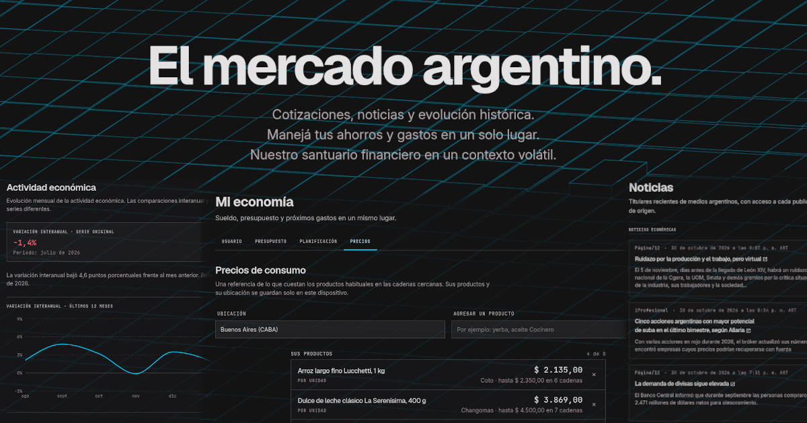

# Tu Economía

Economic monitoring platform for Argentina.

 

**Tu Economía** provides a precise, minimalist interface for monitoring exchange rates and economic indicators. It is a reliable reference for freelancers, remote workers and savers who need to preserve purchasing power and make independent, informed decisions without the noise of economic anxiety.

## 1. Argentine Economic Context

In Argentina, volatility is a daily reality and the "Dólar" is a unit of account as much as a currency. Centralizing the relevant numbers in one place gives people a coherent view of an otherwise fragmented landscape.

## 2. Tech Stack and Development

### 2.1 Libraries and Tooling

- **Routing:** React Router v8 (SSR).
- **State Management:** Prefer URL state and Router loaders.
- **Hosting:** Cloudflare Workers, with static assets served by the same deployment.
- **Accounts and storage:** Better Auth and Cloudflare D1, email through Resend, and subscriptions through Mercado Pago.
- **Validation:** Zod, at the API boundary.
- **Styling:** Tailwind CSS v4, with the system described in [DESIGN.md](DESIGN.md).
- **Fonts:** self-hosted variable Geist, Inter and JetBrains Mono from Fontsource 5.3.0.
- **UI libraries:** react-icons, Recharts, motion, Lenis.
- **Tests:** Vitest.

#### 2.1.1 Data Sources

Exchange rates, indicators, activity data, company filings, equity quotations, news and product prices come from public APIs, feeds and archives. Each source, its cache and its fallback are listed in [docs/market-data.md](docs/market-data.md), [docs/rss-sources.md](docs/rss-sources.md) and [docs/product-price-feed.md](docs/product-price-feed.md).

##### 2.1.1.1 Search Entities

The top-bar search indexes the five exchange-rate cards, identified by their Dólar API `casa` code, and the Acciones panels. Single tickers and companies are not indexed. A record belongs in the index only when its destination can reveal the selected item, so search never returns a dead entry.

The shared model is `app/lib/search-entities.ts`, the rate index `app/lib/exchange-rate-search.ts` and the panel index `app/lib/equity-search.ts`.

### 2.2 Code Quality Standards

- Strict TypeScript configurations are non-negotiable.
- **Styling:** Use the custom Tailwind v4 utilities in `/app/css` and the design tokens in `tailwind-theme.css`; avoid hardcoded values in JSX.
- Contributor rules, including the codebase layout and verification steps, are in [AGENTS.md](AGENTS.md).

#### 2.2.1 Component Architecture

Components are organized by responsibility:

- **UI Components** (`app/components/ui`): Atomized, reusable elements (Button, Card, Sparkline) with zero side effects.
- **Feature Components** (`app/components/features`): Domain-specific logic (ExchangeRateCard, HistoricalExchangeChart, PersonalFinanceTracker).
- **Layout Components** (`app/components/layout`): Page chrome (Navbar, Sidebar, TopBar, Footer).
- **Page shells** (`app/layouts`): `marketing` for the front pages and `terminal` for the dashboard app.

#### 2.2.2 Quirks

- **Meta Tags:** Every page route builds its title, canonical, OpenGraph and Twitter tags through the `pageMeta` helper in `app/lib/meta.ts`, which attaches the shared 1200×630 social preview image (`app/assets/OG-image.png`).
- **Internationalization:** While the UI is in Spanish, the codebase and documentation remain in English to maintain engineering standards.

### 2.3 Build

Vite serves as the build tool and development server.

The Cloudflare Vite plugin runs server code in the Workers runtime during development and preview.

The project is pnpm-managed; `mise.toml` and `packageManager` in `package.json` pin the same pnpm version, and `.node-version` pins the Node.js build version.

1. Clone the repository.
2. Provision pnpm: `mise install`.
3. Install dependencies: `mise exec -- pnpm install --frozen-lockfile`.
4. Local D1 (Miniflare) starts empty; see [docs/cloud-finance-setup.md](docs/cloud-finance-setup.md).
5. Start the development server: `mise exec -- pnpm dev`.

> For a local production preview, run `mise exec -- pnpm build` followed by `mise exec -- pnpm preview`.

> To validate the Worker bundle and assets without publishing, run `mise exec -- pnpm exec wrangler deploy --dry-run` after building.

Before committing, run `mise exec -- pnpm test`. It groups formatting, lint, typecheck, unit tests, and the build in one command.

#### 2.3.1 Configuration

Build variables, runtime variables, secrets and flags are documented in [docs/cloudflare-deployment.md](docs/cloudflare-deployment.md) and [docs/cloud-finance-setup.md](docs/cloud-finance-setup.md).

#### 2.3.2 Dev Preview Params

Production builds ignore these.

| Parameter              | Where                                                                                                                                                                                                                                              | Effect                            |
| ---------------------- | -------------------------------------------------------------------------------------------------------------------------------------------------------------------------------------------------------------------------------------------------- | --------------------------------- |
| `?preview=unavailable` | `/dashboard`, `/analisis`, `/noticias`, `/indicadores`, `/acciones` (also `?panel=empresas&empresa=YPF`, `?panel=calculadora` for the manual-rate state, and `?panel=acciones` with BYMA on), `/mi-economia` (inflation and prices), `/api-status` | Simulates unavailable data states |
| `?preview=sent`        | `/mi-economia?tab=usuario`                                                                                                                                                                                                                         | Shows the "link sent" message     |
| `?preview=error`       | `/mi-economia?tab=usuario`                                                                                                                                                                                                                         | Shows the retry/error notice      |

To review the route-level error screens, open a path that does not exist (404) or trigger a server error in development (500).

### 2.4 Routes

Every route, page or endpoint, is declared in `app/routes.ts`.

| Route                | Description                                                                                                                                                                                                                    |
| -------------------- | ------------------------------------------------------------------------------------------------------------------------------------------------------------------------------------------------------------------------------ |
| `/`                  | Home: introduction to the quotations, history and news, with their sources and methodology                                                                                                                                     |
| `/dashboard`         | Live exchange rates with sparklines, daily variation and stale-data fallback                                                                                                                                                   |
| `/analisis`          | Blue–Oficial gap over time, purchasing-power estimate and deposit-vs-inflation comparison                                                                                                                                      |
| `/indicadores`       | Monthly and annual inflation, 30-day deposit rate, UVA, country risk and EMAE activity                                                                                                                                         |
| `/acciones`          | Argentine companies listed in the US (SEC EDGAR), a CEDEAR theoretical-price calculator and, while `EQUITIES_BYMA_ENABLED` is on, delayed BYMA quotations; panels and parameters in [docs/market-data.md](docs/market-data.md) |
| `/noticias`          | Aggregate of economic news                                                                                                                                                                                                     |
| `/mi-economia`       | Personal salary, budget and price tracker                                                                                                                                                                                      |
| `/api-status`        | Health and cache status of every upstream data source                                                                                                                                                                          |
| `/docs`              | Sources, calculations, update frequency and limits of the data shown                                                                                                                                                           |
| `/privacy`, `/terms` | Privacy policy and service terms                                                                                                                                                                                               |

#### 2.4.1 Mi economía

_Mi economía_ is a cloud-synced salary and savings tracker: monthly income and budgets per category, manually recorded expenses (never presented as a bank balance), upcoming expenses and savings goals, salary purchasing power across months, and reference prices of everyday products near the user's city. Its tabs, data and calculations are in [docs/personal-finance.md](docs/personal-finance.md), and access, storage and retention in [docs/cloud-finance-setup.md](docs/cloud-finance-setup.md).

### 2.5 Further Documentation

[docs/README.md](docs/README.md) indexes the feature and operations guides.

## 3. Security and Legal Considerations

### 3.1 Disclaimer

All financial data is for informational purposes only. This platform is **not a financial advisor**; consult a professional before making significant investment decisions.

### 3.2 License and Contributing

The source is published under the [PolyForm Noncommercial License 1.0.0](LICENSE): free to use for noncommercial purposes. It is source-available, not open source.

Contributions are welcome under the [Individual Contributor License Agreement](CLA.md); [CONTRIBUTING.md](CONTRIBUTING.md) explains what it means and how to accept it.

## 4. Not Built (yet)

- Stock prices on the dashboard;
- More cryptocurrency rates beyond the USDT quotation;
- Secondary market alerts;
- Savings-scenario tools for longer-term financial planning.
